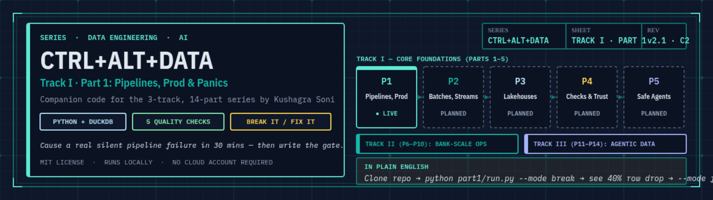
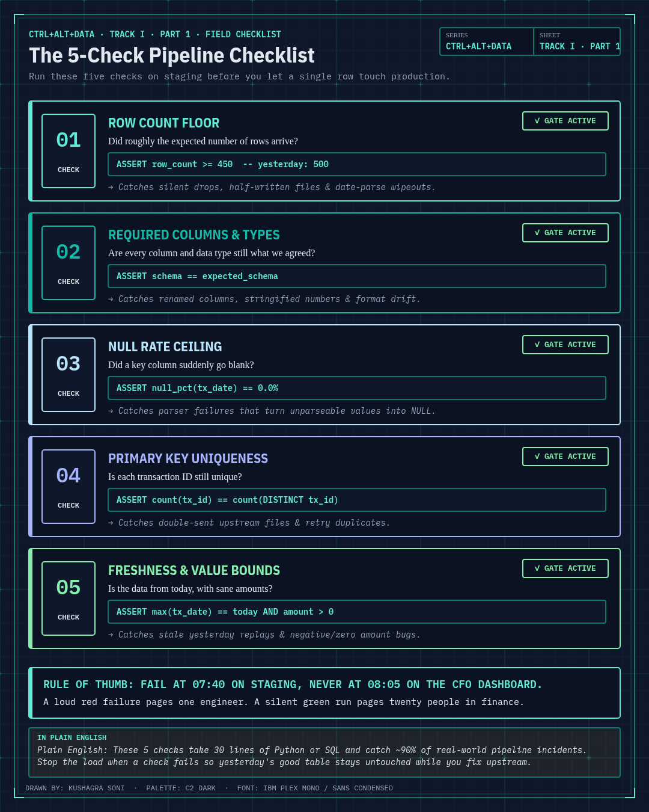

<p align="center">
  
</p>

# CTRL+ALT+DATA

**Your pipeline ran green last night. Are the numbers right?**

If you hesitated, this repo is for you.

I'm Kushagra Soni, a Solutions Architect. I design data and AI platforms for banks, which mostly teaches you what breaks, when it breaks, and who gets the phone call. CTRL+ALT+DATA is my 14-part series across three tracks on Medium about the job behind the dashboards. The articles explain the ideas. This repo is where you get your hands dirty. Each part comes with a small exercise you run on a laptop, break on purpose, and fix. Part 1 is ready now and takes under half an hour.

Everything here runs offline with Python and three packages.

## A scenario you'll recognise

*Made up, but only just.*

On Friday, the team that sends you a daily payments file ships a small tidy-up: dates go from `2026-03-06` to `06/03/2026`. Nobody tells you, because to them it's cosmetic.

Monday, 07:40, your job runs. Green tick. No errors. At 08:00 the dashboard refreshes and shows a strangely quiet period, about 40% fewer transactions than usual. By 08:05 someone in finance has posted a screenshot to a group chat with one word: "?"

What happened? The parser couldn't read the new dates and turned them into nulls. The cleaning step did exactly what it was told and dropped every row without a date. Every line of code worked. The pipeline was still wrong.

One check saying "expected at least 450 rows, got 291" would have stopped the load at 07:40 and paged one person, instead of surprising twenty at 08:05. In Part 1 you cause that incident yourself, in a sandbox, and then write the check.

## The series

Fourteen parts across three tracks. Article links and exercises land here as each part is published. Follow the whole series on Medium: [CTRL+ALT+DATA reading list](https://medium.com/@sonikushagra/list/ctrlaltdata-rebooting-data-engineering-999754cc543a).

### Track I — Core Foundations: From Raw Data to Safe Agents

| Part | Topic | Status | Article |
|---|---|---|---|
| [Part 1](part1/) | **Pipelines, Prod & Panics**: what data engineers actually do | Exercise ready | [Read on Medium](https://medium.com/@sonikushagra/week-1-pipelines-prod-panics-f46c95d39f9a) |
| [Part 2](part2/) | **Batches, Streams & Screams**: ingestion, batch vs streaming, ETL vs ELT | Coming soon | _link coming_ |
| [Part 3](part3/) | **Warehouses, Lakes & Lakehouses**: open table formats & Apache Iceberg | Coming soon | _link coming_ |
| [Part 4](part4/) | **Checks, Tests & Trust**: data contracts & Write-Audit-Publish | Coming soon | _link coming_ |
| [Part 5](part5/) | **Agents, Audits & Accountability**: governed AI agents on data | Coming soon | _link coming_ |

### Track II — Production Reality: Operating at Bank Scale

| Part | Topic | Status | Article |
|---|---|---|---|
| [Part 6](part6/) | **Schemas, Drift & Disasters**: schema evolution & upstream breaks | Coming soon | _link coming_ |
| [Part 7](part7/) | **Orchestrators, Schedules & SLAs**: DAGs, retries, idempotent backfills | Coming soon | _link coming_ |
| [Part 8](part8/) | **Catalogs, Lineage & Locks**: Polaris catalog, column lineage, BCBS 239 | Coming soon | _link coming_ |
| [Part 9](part9/) | **Compaction, Costs & Cold Sweat**: small-file problem, snapshot expiry | Coming soon | _link coming_ |
| [Part 10](part10/) | **Metrics, Traces & Midnight Pages**: data + pipeline observability | Coming soon | _link coming_ |

### Track III — Unstructured & Agentic Data Engineering

| Part | Topic | Status | Article |
|---|---|---|---|
| [Part 11](part11/) | **PDFs, Tables & Trouble**: Document AI into Iceberg lakehouses | Coming soon | _link coming_ |
| [Part 12](part12/) | **Chunks, Vectors & Verifiability**: hybrid knowledge search with citations | Coming soon | _link coming_ |
| [Part 13](part13/) | **Prompts, Policies & Permissions**: row/column security & guardrails for agents | Coming soon | _link coming_ |
| [Part 14](part14/) | **Runbooks, Rollbacks & Regulators**: exam-ready audit trails | Coming soon | _link coming_ |

## Quickstart

You need Python 3.10 or newer. On macOS and Linux:

```bash
git clone https://github.com/kushagrasoni/ctrl-alt-data.git
cd ctrl-alt-data
python3 -m venv .venv
source .venv/bin/activate
python -m pip install -r requirements.txt
python part1/run.py
```

On Windows (PowerShell), the same thing with Windows paths:

```powershell
git clone https://github.com/kushagrasoni/ctrl-alt-data.git
cd ctrl-alt-data
py -m venv .venv
.venv\Scripts\Activate.ps1
python -m pip install -r requirements.txt
python part1/run.py
```

(In `cmd.exe`, activate with `.venv\Scripts\activate.bat` instead.)

**About the data:** the transactions are generated by `part1/data/generate.py` from a fixed seed, so everyone gets the same file. The accounts, amounts and partner are made up. There are no real customers and no company data anywhere in this repo.

The last command builds the finished Part 1 pipeline and should end with `LOADED: 486 rows`. Now test it:

```bash
python -m pytest part1 -v
```

**Prefer uv?** Swap the venv and pip lines for these, then activate `.venv` as above:

```bash
uv venv
uv pip install -r requirements.txt
```

## Part 1 in four steps

The full instructions, with the commands for each step, are in [part1/README.md](part1/README.md).

1. **Warm-up (10 min, optional):** run the finished pipeline, hunt for the mess in the CSV, and answer the five questions in `pipeline_card.yaml`.
2. **Main exercise (10 min):** finish `clean()` and `load()` in `part1/starter/pipeline.py`.
3. **Break it (5 min):** `python part1/run.py --target starter --break date-format`, and watch it load the wrong numbers without complaint.
4. **Fix it (10 min):** write the row count and freshness checks, replay the incident, and watch it stop.

Experienced? There's a "go further" section with a schema contract, an allowed-values check and an alert hook.

## The five questions

Part 1 closes with the five questions I run through before building any pipeline. The exercise turns each one into something in the code: a field in the pipeline card, a check, or a decision the runner makes. The [mapping is in the Part 1 README](part1/README.md#the-five-questions-in-code).

<p align="center">
  
</p>

## Starter vs solution

Every part has the same two folders:

- **`starter/`** is yours. It has the boring parts done and clear `TODO`s where the thinking goes.
- **`solution/`** is my version. It passes every test.

Commands default to the solution. Add `--target starter` to run or test your own code:

```bash
python part1/run.py --target starter                # run your pipeline
python part1/run.py --check --target starter        # test it
python -m pytest part1 --target starter -m core     # the same tests, plain pytest, one stage
```

Your starter tests will fail at first. That's the to-do list.

## Repo layout

```
ctrl-alt-data/
  part1/             Track I · Part 1 exercise: starter/, solution/, tests/, run.py
  part2/ - part14/   scaffolds for Track I (Parts 2–5), Track II (Parts 6–10), Track III (Parts 11–14)
  assets/            banner (drawn by assets/make_banner.py) and the Part 1 checklist graphic
  requirements.txt   duckdb, pandas, pytest
```

## Contributing

Found a bug, a confusing step, or a command that doesn't work on your machine? Open an issue and tell me your OS and Python version. Small fixes are welcome as pull requests: run `python -m pytest part1 -v` first, and keep the starter's TODOs intact.

## License

[MIT](LICENSE). The code is yours to reuse.
