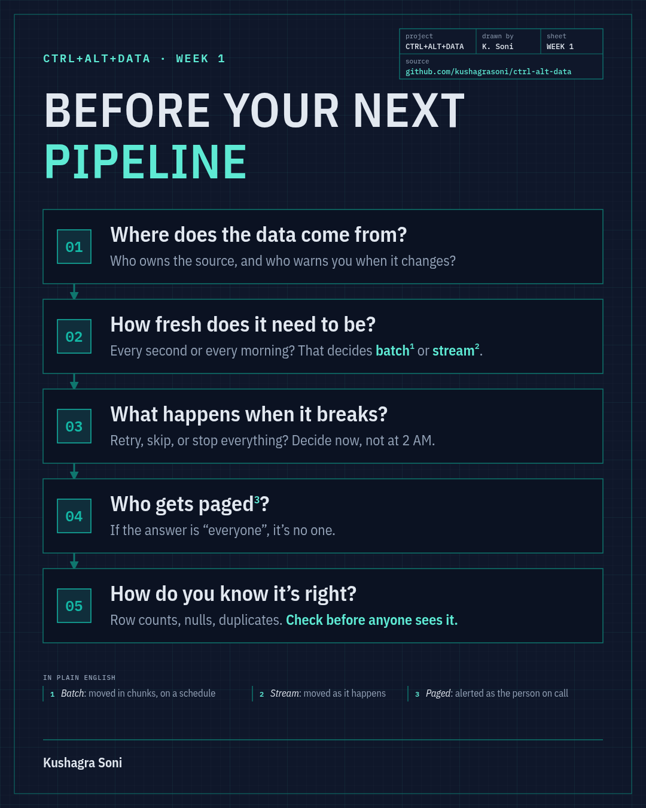

# Week 1: Pipelines, Prod & Panics

**The exercise:** build a tiny pipeline that reads a messy CSV, cleans it and loads it into DuckDB. Then break it the way upstream systems really break things, and add the checks that would have caught it.

**Time:** about 20 minutes for the main path (exercise, break, fix). Add 10 for the warm-up if you're new to this, and 15 to 20 for "go further" if you're not.

**You need:** Python 3.10+ and the three packages in [`requirements.txt`](../requirements.txt). No cloud account, no Docker, no network. Set up once from the repo root ([quickstart](../README.md#quickstart)), then every command below runs from the repo root too.

```
python week1/run.py
```

That runs the finished solution end to end. Everything else on this page is you making the starter do the same.

---

## The five questions, in code

The Week 1 article closes with the five questions I run through before building any pipeline. Here, each one is something you can open, run or break.

| Question | Where it lives in this exercise |
|---|---|
| 1. Where does the data come from? | `source` in [`pipeline_card.yaml`](starter/pipeline_card.yaml) (system, owner, contract columns) and `check_schema`, which fails when the file stops matching the contract |
| 2. How fresh does it need to be? | `freshness.max_lag_days` in the card, enforced by `check_freshness` |
| 3. What happens when it breaks? | `on_failure.action` in the card. `stop` means the runner loads nothing and yesterday's table stays as it was |
| 4. Who gets paged? | `on_call.primary` in the card, used by `notify()` in `alerts.py` |
| 5. How do you know it's right? | `correctness` in the card: `check_row_count`, `check_unique`, `check_not_null`, `check_allowed_values`, all run **before** the load |

<p align="center">
  
</p>

## How it fits together

```
landing CSV --> extract --> check_schema --> clean --> row count, freshness,   --> load into DuckDB
(generated)                                            unique, not null,             (CREATE OR REPLACE)
                                                       allowed values
                                     any check fails? --> notify on-call, and with action: stop, load nothing
```

`run.py` writes a fresh copy of the feed into `week1/.work/<target>/landing/` on every run, so you can break it as often as you like. The DuckDB file and `alerts.log` live next to it. Delete `.work/` whenever you want a clean slate (or pass `--fresh`).

The exercise runs with a pinned "today" of 2026-03-07 so everyone sees the same numbers. In production that would be the real date.

---

## Warm-up (10 minutes, for beginners)

1. Run the finished pipeline and read the output top to bottom:
   ```
   python week1/run.py
   ```
2. Open `week1/data/raw/transactions.csv` in an editor or spreadsheet. It's a messy week of transactions from a partner payments feed. (It's generated by `week1/data/generate.py` from a fixed seed. The accounts, amounts and partner are made up, with no real customers or company data.) Find five kinds of mess: an extra column nobody asked for, the same transaction delivered twice, dates that aren't dates, missing amounts, and currency codes written three different ways. (Answers at the bottom of this page.)
3. Ask the warehouse a question. This queries the table the solution just loaded:
   ```
   python week1/run.py --sql "SELECT currency, count(*) AS n FROM transactions GROUP BY currency ORDER BY n DESC"
   ```
4. Fill in [`week1/starter/pipeline_card.yaml`](starter/pipeline_card.yaml). Replace every `TODO` with your answer. The numbers you choose become the thresholds your checks enforce later, so pick them on purpose: the clean feed has 486 rows, and the newest transaction should be at most a day old. Then check your card:
   ```
   python week1/run.py --check --stage warmup --target starter
   ```

## Main exercise (about 10 minutes)

Open [`week1/starter/pipeline.py`](starter/pipeline.py) and work through **TODO 1 to 5**:

1. Tidy the headers and keep only the contract columns (this drops `legacy_branch_code`).
2. Strip whitespace and upper-case the currency codes.
3. Parse `txn_date` with an explicit format and `amount` as a number. Anything that doesn't fit becomes empty, not a guess.
4. Drop rows with no date or no amount, then keep one row per `txn_id`.
5. Load into DuckDB so that running twice gives the same table, not double the rows.

Delete each `raise NotImplementedError` line as you finish that function. Run your pipeline until it prints `LOADED: 486 rows`:

```
python week1/run.py --target starter
python week1/run.py --check --stage core --target starter
```

Run it a second time. Still 486? Then your load is idempotent.

## Break it (5 minutes)

Over the "weekend", the upstream team changed the date format for the two most recent days from `2026-03-06` to `06/03/2026`. Nobody told you. Run your pipeline against that feed:

```
python week1/run.py --target starter --break date-format
```

Look closely. Your row count and freshness checks show up as `TODO`, and the run reports `LOADED: 291 rows`. No error, no crash, and 40% of the week gone. Check the newest `txn_date` it prints, too.

Before you fix anything: which of the five questions would have caught this?

## Fix it (10 minutes)

Open [`week1/starter/checks.py`](starter/checks.py) and write the two checks that would have caught it:

- **TODO 6** `check_row_count`: fail when there are fewer clean rows than `correctness.min_rows` in your card.
- **TODO 7** `check_freshness`: fail when the newest `txn_date` is more than `freshness.max_lag_days` behind as-of.

Now replay the incident. Load a good feed first, then send in the broken one:

```
python week1/run.py --target starter
python week1/run.py --target starter --break date-format
```

The second run should end with `STOPPED` and `Warehouse: still 486 rows from the last load`. Same bad file, but this time it never reached anyone. Try a late file too, where Friday's rows simply never arrive:

```
python week1/run.py --target starter --break late
python week1/run.py --check --stage fix --target starter
```

**Why not just parse both date formats?** You could, once the source owner (question 1) confirms what changed. Guessing is how this goes wrong: pandas reads `06/03/2026` as 3 June unless you tell it otherwise. The check buys you the time to ask.

## Go further (for experienced readers, 15 to 20 minutes)

- **TODO 8, schema contract.** Upstream renames `txn_date` to `transaction_date`. Without a contract, the run stops with `clean() crashed: KeyError: ...`, which tells you where it fell over but not why. Write `check_schema` so the run stops before cleaning, with a message that names the missing column:
  ```
  python week1/run.py --target starter --break rename
  ```
- **TODO 9, allowed values.** Write `check_allowed_values` so a currency outside the card's list fails the batch.
- **TODO 10, a real alert hook.** Right now `notify()` in [`starter/alerts.py`](starter/alerts.py) shouts into the terminal and tells nobody. Make it append a JSON line to `alerts.log` addressed to `on_call.primary` from your card.
- **No tests for these, just think:**
  - Set `on_failure.action: warn` in your card and rerun the broken feed. When would you actually want that?
  - Pass `--as-of 2026-03-09` (a Monday). With `max_lag_days: 1` the freshness check fails, because the feed has no weekend rows and Friday is three days back. How would you write a freshness rule that understands weekends?

Check everything at once:

```
python week1/run.py --check --target starter
```

## Starter vs solution

- `starter/` is yours. Edit it freely. `--target starter` runs and tests your code.
- `solution/` is my version. It's the default target, so `python week1/run.py` and `python -m pytest week1` use it. Peek when you're stuck, but try the TODO first.
- `runner.py`, `card.py`, `data/` and `tests/` are shared by both. You don't need to change them.

`python week1/run.py --check --target starter` is a shortcut for `python -m pytest week1 --target starter`. Add `--stage warmup|core|fix|further` to run one stage (that's `-m <stage>` in pytest).

| File | What it is |
|---|---|
| `run.py` | the one command: run, break, query, test |
| `runner.py` | extract, check, clean, check, load or stop |
| `card.py` | reads `pipeline_card.yaml` (a small YAML subset, so you don't need a YAML library) |
| `data/generate.py` | builds the feed from a fixed seed, plus the `--break` variants |
| `data/raw/transactions.csv` | the normal feed as it lands, committed so you can open it without running anything |
| `starter/`, `solution/` | `pipeline.py`, `checks.py`, `alerts.py`, `pipeline_card.yaml` |
| `tests/` | pytest, marked `warmup`, `core`, `fix` and `further` |

<details>
<summary>Warm-up answers: the five kinds of mess</summary>

- **Extra column:** `legacy_branch_code`, mostly empty.
- **Duplicates:** 15 transactions appear twice. Some copies differ only in currency casing, so dropping exact duplicate rows misses them.
- **Bad dates:** 6 rows, including `2026-02-30`, `2026-13-01`, `N/A` and an empty value.
- **Missing amounts:** 8 rows with an empty `amount`.
- **Mixed-case codes:** `INR`, `inr`, `Inr` and ` INR ` with spaces.

515 raw rows, minus 15 duplicates, 6 bad dates and 8 missing amounts, leaves 486.
</details>
